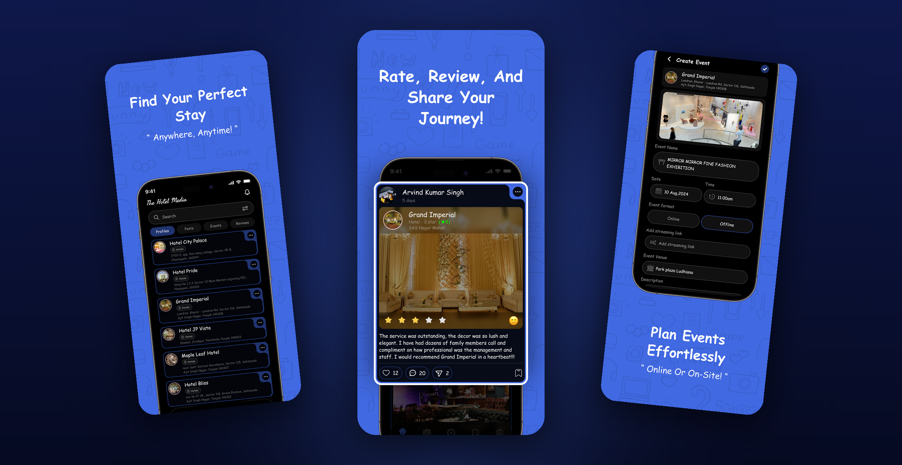
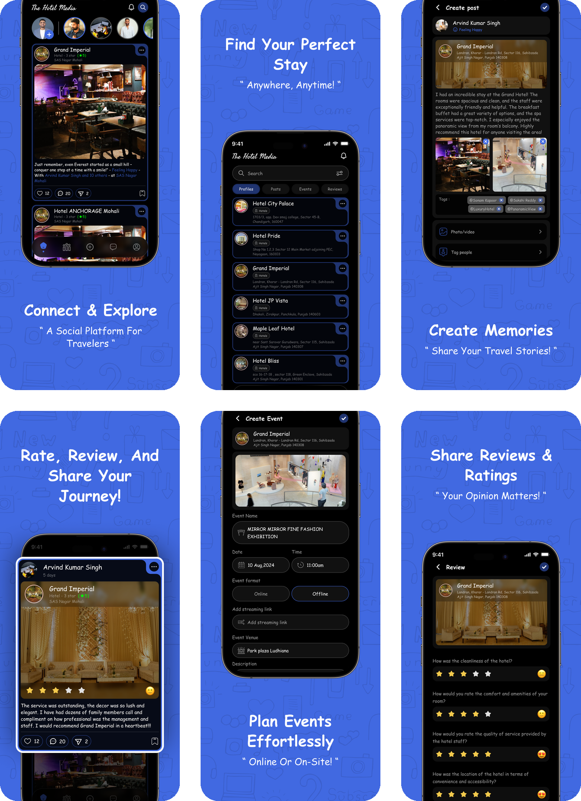

# The Hotel Media

**Where social media meets hospitality.**

Discover, review and book hotels, restaurants, bars, banquets and events in one social app. 
Guests share real stays and meals. Venues post, take bookings and food orders, and sell event tickets, without paying booking commissions.

[Website](https://thehotelmedia.com) ·
[App Store](https://apps.apple.com/in/app/the-hotel-media/id6670192036) ·
[Google Play](https://play.google.com/store/apps/details?id=com.thehotelmedia.android) ·
[Report a bug](https://github.com/soensingh/the-hotel-media/issues/new/choose) ·
[Discussions](https://github.com/soensingh/the-hotel-media/discussions)

 

## What it does

Booking apps show you a listing. Social apps show you a feed. The Hotel Media puts the two together: every hotel, restaurant, bar and banquet hall has a profile with posts, reels, stories and honest reviews, and a button to book a room, reserve a table, order food or buy an event ticket.

### For guests and travelers

- **A feed from the places you love.** Posts, reels, stories and short notes from venues and people you follow. Like, comment, reply, save, and share to a chat.
- **Reviews that mean something.** Rate a stay on the things that matter (cleanliness, comfort, service, location), add photos, and read what other guests really thought.
- **Find a place fast.** Search profiles, posts, events and reviews, browse venues **Nearby**, or find people by **Profession**.
- **Book straight from the profile.** Reserve rooms and tables, pay in the app, and keep every booking in your history.
- **Order food.** Browse a restaurant's or café's menu, check out, and track your order to the door. A one-time code confirms the handover.
- **Go to events.** Weddings, live shows, club nights and exhibitions. Join free events or buy tickets, keep a QR ticket in the app, and get directions.
- **Chats and calls.** One-to-one and group chats, plus voice and video calls.
- **Jobs.** Browse openings at hotels, restaurants and venues, and apply in the app.
- **Your profile, your way.** A share link and QR code for your profile, private accounts and follow requests, block and report, light or dark theme, and the app in English, हिन्दी or ਪੰਜਾਬੀ.

### For hotels, restaurants, bars and banquets

- **A business profile that sells.** Photos, reels, amenities, your location on the map, and reviews in one place.
- **Bookings with no commission.** Room and table categories and a bookings dashboard, on a flat monthly plan instead of a cut of every booking.
- **Menu and food delivery.** Build your menu in the app, or **scan a photo of your printed menu** to fill it in, then take online orders.
- **Events and ticketing.** Create free or paid events, see who's coming, and check tickets at the door with a QR scanner that runs in any browser, so door staff don't need the app.
- **Hiring.** Post jobs and review applicants.
- **Insights.** Accounts reached, engagement, followers, website visits and how each post and story performed.
- **Several pages, one login.** Run more than one venue from a single phone number and switch between them.
- **A web console.** Run bookings, rooms and tables, your menu and food orders, events and earnings from a computer at [property.thehotelmedia.com](https://property.thehotelmedia.com). Sign in by scanning a QR code with the app.

## Screens

  

## Download

<table>
<tr>
<td><b><a href="https://apps.apple.com/in/app/the-hotel-media/id6670192036">Download on the App Store</a></b></td>
<td>iPhone, iOS 15 or later</td>
</tr>
<tr>
<td><b><a href="https://play.google.com/store/apps/details?id=com.thehotelmedia.android">Get it on Google Play</a></b></td>
<td>Android 7.0 or later</td>
</tr>
</table>

1. Install the app and sign in with your mobile number. You'll get a one-time code by SMS.
2. Pick an account type: **Individual** to explore, review and book, or **Business** to list your venue.
3. Follow a few places, and you're in.

The app is free for guests. You pay only for what you book, order or buy a ticket for.

## Business plans

Listing a business needs a monthly plan. The app shows the plans that fit your business type.

| Business type | Plan | Per month | Bookings and ordering included |
|---|---|---:|---|
| **Hotel** | 5 Star | **₹19,999** | Rooms, tables, menu and food delivery |
| | 4 Star | **₹11,999** | Rooms, tables, menu and food delivery |
| | 3 Star and below | **₹7,999** | Rooms, tables, menu and food delivery |
| **Restaurant, Bar or Club** | Restaurants / Nightclubs / Bars | **₹6,999** | Tables, menu and food delivery |
| **Restaurant** (cafés, QSRs, bakeries) | Café / QSR | **₹2,999** | Menu and food delivery |
| **Home Stay or Marriage Banquet** | Homestay / Banquets & Halls / Concept Stay | **₹2,999** | Room and hall bookings |

Every plan includes the business profile, posts, reels, stories, reviews, events, job posts and Insights. Prices can change; the app always shows the current price before you subscribe.

## Privacy

- You sign in with your mobile number and a one-time code. There's no password to leak.
- The camera, microphone and photo library are used only when you take or pick something to post, or when you're on a call. Location is used only when you allow it, to show places near you and to set a business's address.
- Payments go through Razorpay, the App Store or Google Play. Your card and UPI details go to them, not to us.
- The app has no third-party ad or analytics SDKs.
- Delete your account from **Settings → Delete Account**. You have 30 days to change your mind by signing in again; after that, your profile and content are permanently deleted. Payment and booking records are kept as the law requires.

Full details: [privacy policy](https://thehotelmedia.com/privacy-policy) · [terms and conditions](https://thehotelmedia.com/terms-and-conditions).

## FAQ

<b>Is the app free?</b>

Yes, for guests. Downloading, posting, reviewing, chatting and calling are free. You pay only for the rooms, tables, food and event tickets you book. Businesses pay a monthly plan (see [Business plans](#business-plans)).

<b>Do businesses pay a commission on bookings?</b>

No. Businesses pay a flat monthly plan, not a percentage of each booking.

<b>How do I list my hotel, restaurant or venue?</b>

Download the app, sign in, choose **Business**, pick your business type and a plan, and fill in your profile. Our team reviews new business accounts before they go live.

<b>Can I manage my venue from a computer?</b>

Yes. Open [property.thehotelmedia.com](https://property.thehotelmedia.com) and sign in by scanning the QR code with the app. You can manage bookings, rooms and tables, your menu and food orders, events and earnings there. If you run several venues, switch between them from the same login.

<b>I deleted my account by mistake. Can I get it back?</b>

Yes, within 30 days. Sign in with the same number and the app offers to restore it. A page you deleted on its own (not your whole account) can be restored from **Settings**.

<b>I didn't get the OTP. What should I do?</b>

Check the number and wait a minute before asking again. Too many requests in a short time, especially from one Wi-Fi network, can be blocked for a while to stop abuse. Switching to mobile data or trying again later usually fixes it. Still stuck? Email <a href="mailto:support@thehotelmedia.com">support@thehotelmedia.com</a>.

<b>Which languages does the app support?</b>

English, Hindi and Punjabi. Change it in **Settings → Language**.

## Feedback

This repo is the public home of The Hotel Media's community.

- **Found a bug?** [Open an issue](https://github.com/soensingh/the-hotel-media/issues/new/choose). The template asks for the details that help most.
- **Have an idea or a question?** Start a thread in [Discussions](https://github.com/soensingh/the-hotel-media/discussions).
- **Problem with a payment, booking, order or your account?** Email [support@thehotelmedia.com](mailto:support@thehotelmedia.com). Please don't post phone numbers, OTPs, payment IDs or booking details publicly.
- **Security issue?** See [SECURITY.md](SECURITY.md) and report it privately.

## Under the hood

The apps are built with **Flutter** for iOS and Android from one codebase, in English, Hindi and Punjabi. The backend is **Next.js** with **MongoDB**. Sign-in uses **Firebase Authentication** (phone OTP), push notifications use **Firebase Cloud Messaging**, calls run on **WebRTC**, maps use **Google Maps**, and payments go through **Razorpay** and **App Store / Google Play in-app purchases**.

## Why isn't the source code here?

The Hotel Media is a commercial, closed-source product. This repository is its public home: the changelog, bug reports, ideas and discussions. The app's code lives elsewhere, so there's nothing here to build, fork into an app or send code changes to.

If The Hotel Media helped you find a great stay or fill your venue, starring this repo helps other people find it.

## License

Copyright (c) 2025-2026 Indulge Insight Private Limited. All rights reserved.

The Hotel Media is proprietary software. Your use of the app is governed by the [terms and conditions](https://thehotelmedia.com/terms-and-conditions). The text, images and artwork in this repository may not be copied, modified or redistributed. See [LICENSE](LICENSE) for details.

The Code of Conduct is adapted from the Contributor Covenant 2.1 (CC BY 4.0).
